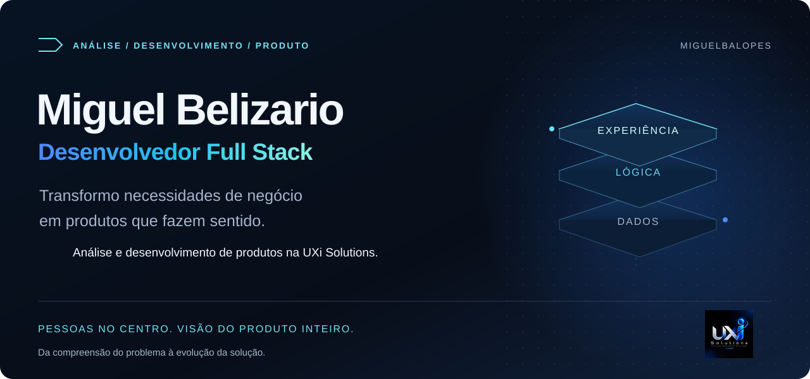
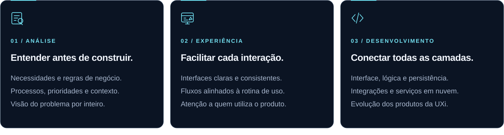

  

  <a href="https://github.com/uxisolutions"><strong>UXi Solutions</strong></a>
  &nbsp;&nbsp; / &nbsp;&nbsp;
  <a href="#minha-atuação"><strong>Minha atuação</strong></a>
  &nbsp;&nbsp; / &nbsp;&nbsp;
  <a href="#tecnologias-e-ferramentas"><strong>Tecnologias</strong></a>
  &nbsp;&nbsp; / &nbsp;&nbsp;
  <a href="mailto:miguelbelizario@uxisolutions.com.br"><strong>Contato</strong></a>

 

## Visão de negócio. Cuidado com a experiência. Código com propósito.

Sou **Miguel Belizario**, Desenvolvedor Full Stack na [**UXi Solutions**](https://github.com/uxisolutions), responsável pela **análise e pelo desenvolvimento dos produtos da empresa**.

Meu trabalho conecta o entendimento das necessidades do negócio à construção de soluções digitais. Atuo das interfaces à lógica de negócio, passando pela persistência dos dados e pelas integrações que sustentam a operação.

Tenho um cuidado especial com a **experiência do usuário**: acredito que um produto deve ser compreensível, útil e coerente com a rotina de quem o utiliza. Essa perspectiva orienta a forma como analiso problemas e desenvolvo funcionalidades.

**Construir software, para mim, é transformar complexidade em uma experiência mais simples.**

 

## Minha atuação

Na UXi, participo da construção e da evolução dos produtos, conectando **necessidades, funcionalidades e implementação**. Meu foco é manter a solução alinhada ao problema que ela precisa resolver, com atenção aos detalhes da experiência e ao funcionamento do sistema.

 

## Tecnologias e ferramentas

Utilizo essas ferramentas conforme as necessidades do projeto, conectando interface, processamento e dados em soluções voltadas ao uso real.

 

## Produtos e projetos

### UXi Agro

Atuação na **análise e no desenvolvimento** de um sistema de gestão que conecta etapas da operação, **da colheita à entrega ao cliente**.

O produto reúne acompanhamento operacional, pedidos, vendas, despesas e indicadores, aproximando a informação de quem precisa utilizá-la para trabalhar e decidir.

[**Conheça a UXi Solutions →**](https://uxisolutions.com.br)

### Validador de carga inicial de funcionários

Projeto em Python voltado à validação de cadastros de funcionários e dependentes. Aplica regras de consistência, identifica duplicidades e gera um resumo dos resultados para apoiar a preparação dos dados.

[**Explore meus repositórios públicos →**](https://github.com/MiguelBALopes?tab=repositories)

 

## Formação e desenvolvimento contínuo

Curso **Análise e Desenvolvimento de Sistemas na Fatec Sorocaba**. Complemento a formação com a prática em produtos, estudos de arquitetura de software e aprofundamento em serviços de nuvem.

Conecto o aprendizado técnico aos desafios que encontro na análise e no desenvolvimento dos sistemas.

 

  <a href="https://github.com/uxisolutions">UXi Solutions</a>
  &nbsp; · &nbsp;
  <a href="https://uxisolutions.com.br">Site da empresa</a>
  &nbsp; · &nbsp;
  <a href="mailto:miguelbelizario@uxisolutions.com.br">E-mail profissional</a>

Miguel Belizario · Tecnologia, produto e experiência.

